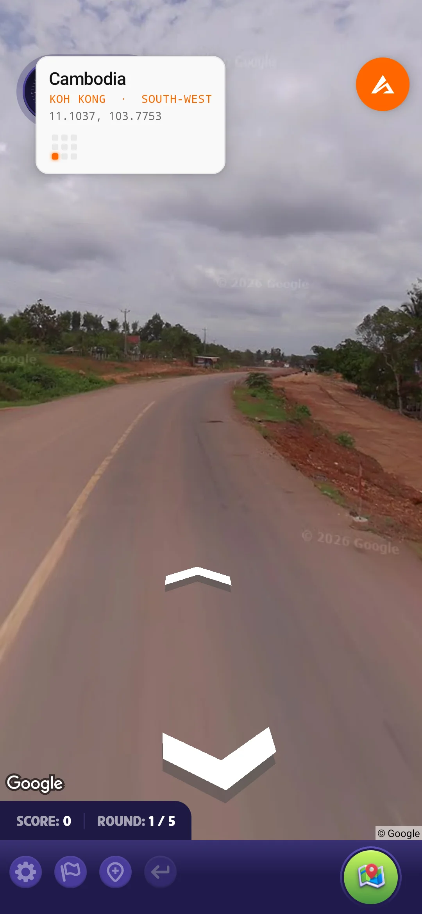
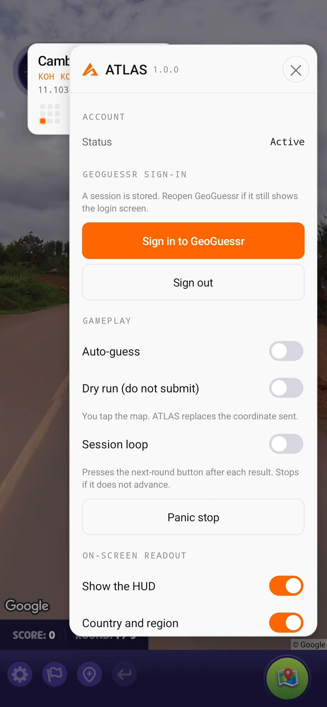

# GeoGuessr APK Mod Menu: ATLAS for Android

  

  <b>A GeoGuessr cheat for Android, installed from an APK, with a mod menu over the round.</b> 
  Country, province and direction while you play, and it can drop the guess for you. Root optional.

  
  
  
  
  
  
  

  <a href="https://github.com/Sven233333/Atlas-geoguessr-bot"><b>All platforms</b></a> &middot;
  <a href="https://geoguessrcheats.com/phone">Install guide</a> &middot;
  <a href="https://github.com/Sven233333/atlas-geoguessr-ios">iPhone</a> &middot;
  <a href="https://geoguessrcheats.com/plans">Plans</a>

An Android build of ATLAS shipped with v1.7 in August 2026. It is not a port of
the iPhone version wearing a different coat: it was written for Android and shares
no code with the iOS build.

While a round is open it shows you the country, the province and a direction, and
it can drop the guess on the map for you. Unlocked with the ATLAS key you already
have.

Full install guide: **[geoguessrcheats.com/phone](https://geoguessrcheats.com/phone)**

---

## What your phone needs

| | |
|---|---|
| Android version | 9 or newer |
| Memory | 4 GB of RAM |
| Architecture | 64 bit device |
| Licence | The same ATLAS key as desktop and browser |

## Two ways in, and they are genuinely different

**Stock phone, nothing unlocked.** This is what most people take. One file, a
split installer, then sign in with your key exactly like the iPhone app does.
Nothing about your phone has to be modified.

**Rooted phone.** The safer of the two if you already have root, because it leaves
the GeoGuessr app from the Play Store completely untouched. It loads through
LSPosed, so nothing is re-signed, and signing in with Google keeps working the
ordinary way.

Both routes are written out step by step, with the screens you will see, on the
[install page](https://geoguessrcheats.com/phone). If you get stuck on a step, the
[Discord](https://discord.gg/zwYXRgRRHc) is the fastest way to unstick it.

## What appears while you play

A compact panel rather than an overlay covering the game:

- country
- province, which matters in places where a country level answer is nearly useless
- direction
- auto guess, if you want the pin placed for you
- dry run, which shows what it would have done and then does nothing

## What Android does not get

Session grinding. No phone version starts matches and plays them one after another
while you are elsewhere; that has always been the Windows app and still is:
[atlas-geoguessr-windows-app](https://github.com/Sven233333/atlas-geoguessr-windows-app).

There are also no free rounds on the phone. Those live in the browser extensions,
which is where to look first if you want proof before payment:
[Chrome](https://github.com/Sven233333/atlas-geoguessr-chrome-extension) and
[Firefox](https://github.com/Sven233333/atlas-geoguessr-firefox-addon).

## What a key costs

14.99 euro a month, 33.50 euro for a year, or 50 euro once. Nothing renews unless
you renew it. [geoguessrcheats.com/plans](https://geoguessrcheats.com/plans)

## Questions

**Is it on Google Play?**
No. It installs from a file, which is why the install page walks through it
carefully.

**Do I need root?**
No. The stock route exists precisely so you do not.

**Why would I root then?**
Because the rooted route leaves your installed GeoGuessr app alone and does not
re-sign anything.

**Does it drain the battery?**
The demanding part of the work is not done by your phone.

**Will my desktop key work here?**
Yes. One key, every platform, including
[iPhone](https://github.com/Sven233333/atlas-geoguessr-ios).

**Which Android phones has this been tried on?**
Anything meeting the table above. The requirements are the requirements, not a
list of blessed handsets.

## More

- The overview of every platform: [Atlas-geoguessr-bot](https://github.com/Sven233333/Atlas-geoguessr-bot)
- Comparison table on the site: <https://geoguessrcheats.com/platforms>
- What shipped in v1.7: <https://geoguessrcheats.com/blog/atlas-v17-update/>

## Disclaimer

Independent project with no link to GeoGuessr AB or to Google. Installing software
outside a store, and using an assistant at all, are choices you make against the
rules of whatever you are playing.
